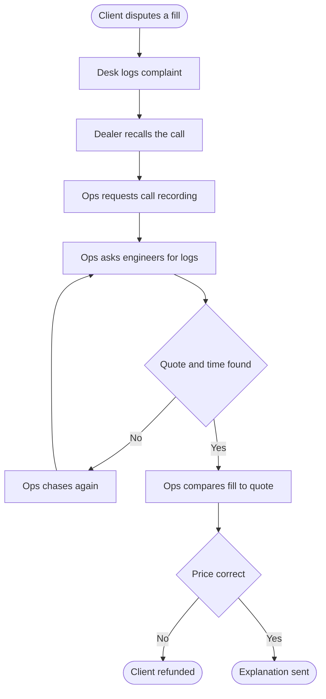

# As-is: answering a client's disputed fill

Source: BRS section 2 and the Module 02 interview with David (disputes take up to two days).

Pain points to discuss:

- P1 Up to two days per dispute, about forty disputes a month
- P2 The answer depends on memory and call recordings
- P3 Engineers are pulled into operations work to find logs
