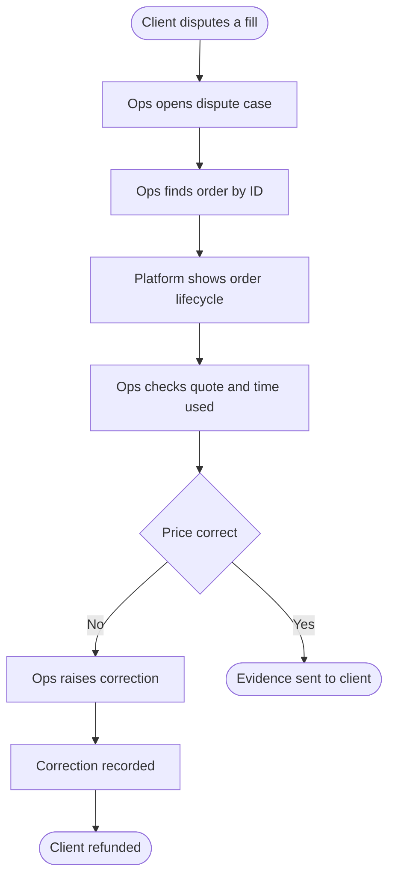

# To-be: answering a disputed fill on the direct trading platform

Sources: BR-08, BR-11, BR-14 and BR-15.

Traceability:

| Step | Requirement |
|---|---|
| Platform shows order lifecycle | BR-15 (reconstruct the full lifecycle) |
| Ops checks quote and time used | BR-08, BR-15 |
| Correction recorded | BR-14 (the original record is never altered) |
| Ops finds order by ID | BR-11 (order history) |
