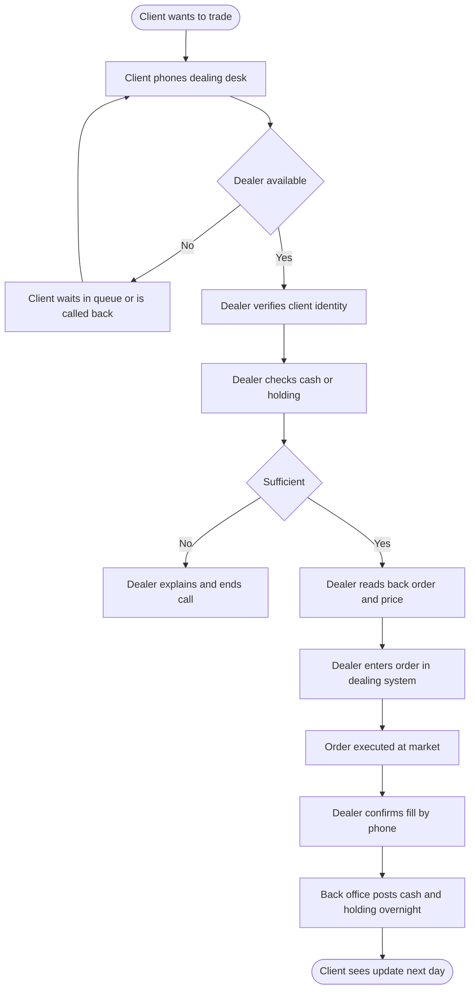

# As-is: client trade through the phone dealing desk

Source: BRS section 2 (Business Background). At present a dealer stands behind every trade.

Pain points to discuss:

- P1 Wait for a dealer (no client self-service)
- P2 Manual re-keying of the order by the dealer
- P3 Holdings and cash updated in an overnight batch, not at the fill
