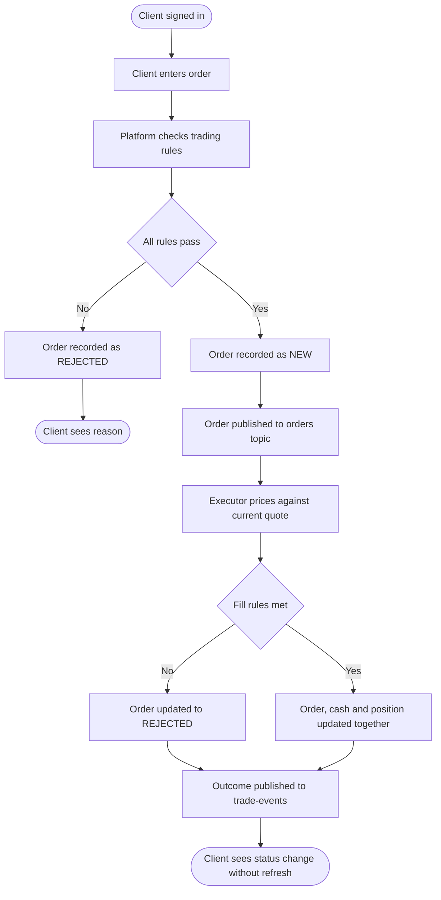

# To-be: client places an order on the direct trading platform

Sources: BR-04 to BR-09, the Trade REST API contract (`shared/contracts/trade-api.yaml`) and
the Kafka topic catalogue (`shared/contracts/kafka-topics.md`).

Traceability:

| Step | Requirement |
|---|---|
| Platform checks trading rules | BR-05 |
| Order recorded as NEW before execution | BR-06 |
| Executor prices against current quote | BR-08 |
| Order, cash and position updated together | BR-09 |
| Client sees status change without refresh | BR-07 |
