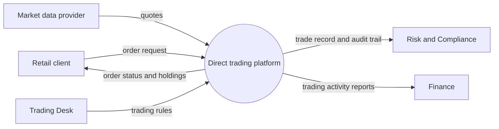

# Context diagram: direct trading platform

The system is one box. Everything outside it is an external entity. Arrows are named data flows.

Sources: BRS section 5 (stakeholders), BR-04, BR-08, BR-10, BR-14, BR-16.
