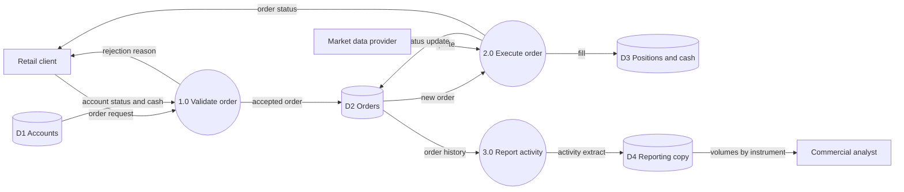

# Level 1 data flow diagram: order placement

Processes are numbered circles, data stores are marked D1 to D4, external entities are
rectangles. Every flow is labelled with the data it carries.

Checks a reviewer applies:

- Every process has at least one input and one output.
- No flow runs directly between two data stores or between two external entities.
- Flows into and out of the platform match the context diagram.
