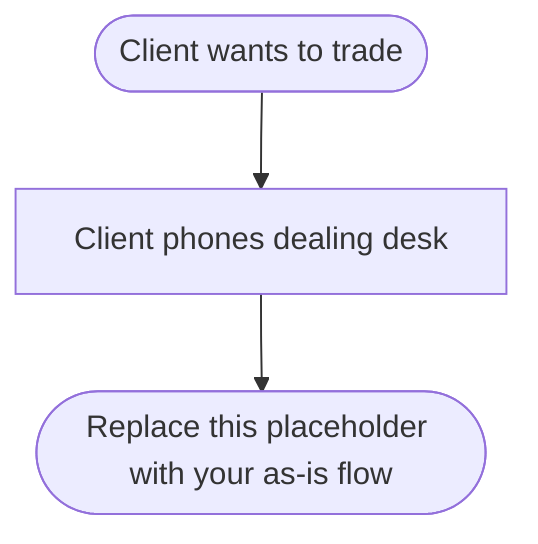
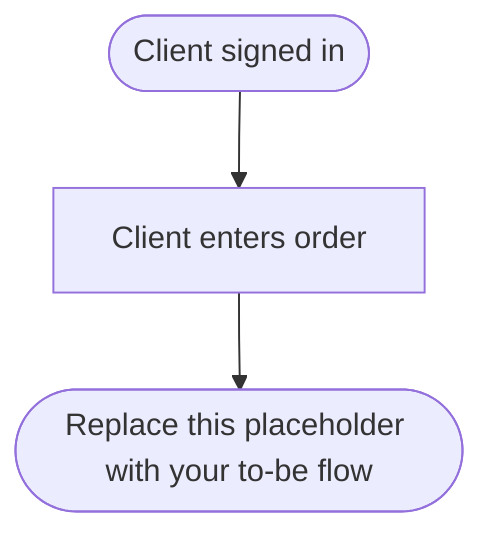

# Process map: client trade (team: ________)

## As-is: client trade through the phone dealing desk

### Pain points

| Ref | Step | Pain point | Stakeholder affected |
|---|---|---|---|
| P1 | | | |
| P2 | | | |
| P3 | | | |

## To-be: client places a buy order on the platform

### Handoffs and automation

| From | To | What is handed over | As-is manual or automated | To-be decision |
|---|---|---|---|---|
| | | | | |
| | | | | |

### Traceability

| To-be activity | Requirement (BR-nn) or open question | Stakeholder |
|---|---|---|
| | | |
| | | |

## Peer review checklist (for the reviewing team)

- [ ] Both diagrams render
- [ ] Every decision has labelled exits
- [ ] Pain points are linked to as-is steps
- [ ] The to-be flow records the order before execution (BR-06)
- [ ] The to-be flow shows the rejection path (BR-05)
- [ ] Cash, position and trade record update together (BR-09)
- [ ] Every to-be activity traces to a BR number or an open question
