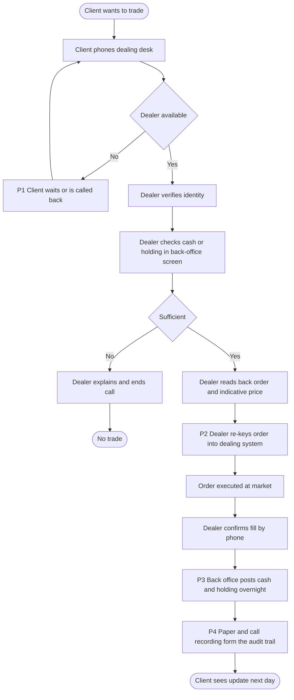
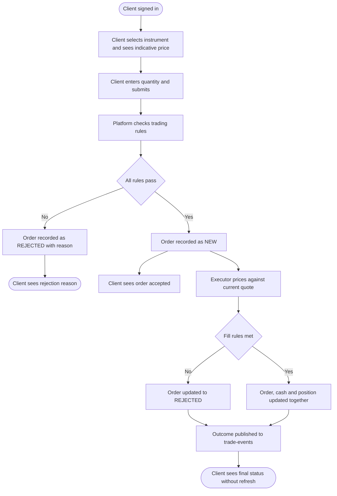

# Process map: client trade (reference solution)

Team versions will differ in detail. A good answer has the elements below.

## As-is: client trade through the phone dealing desk

### Pain points

| Ref | Step | Pain point | Stakeholder affected |
|---|---|---|---|
| P1 | Dealer available | Client waits for a dealer; no self-service | Retail client (Joanna) |
| P2 | Dealer re-keys order | Manual re-keying risks wrong quantity or instrument | Trading Desk (David) |
| P3 | Back office posts overnight | Holdings and cash lag the fill by a day | Retail client, Finance |
| P4 | Audit trail | Reconstructing a disputed trade needs call recordings and paper | Trading Desk, Risk and Compliance |

## To-be: client places a buy order on the platform

### Handoffs and automation

| From | To | What is handed over | As-is | To-be decision |
|---|---|---|---|---|
| Client | Dealer | Order instruction by phone | Manual | Automated: client enters order directly |
| Dealer | Dealing system | Order details | Manual re-key | Removed |
| Dealing system | Back office | Fill for posting | Overnight batch | Automated: posted in the same transaction as the fill (BR-09) |
| Trade REST API | Trade Executor | Accepted order | Not applicable | Automated via the `orders` topic |
| Platform | Risk and Compliance | Audit trail | Call recordings and paper | Automated: order events recorded permanently (BR-14) |

### Traceability

| To-be activity | Requirement or open question | Stakeholder |
|---|---|---|
| Client sees indicative price | BR-13 | Retail client |
| Platform checks trading rules | BR-05 | Trading Desk |
| Order recorded as NEW | BR-06, BR-14 | Risk and Compliance |
| Executor prices against current quote | BR-08 | Trading Desk |
| Order, cash and position updated together | BR-09 | Finance |
| Client sees final status without refresh | BR-07 | Retail client |
| How long a NEW order may wait before it is treated as failed | Open question | Trading Desk (David) |
| Whether a rejected order at execution is shown differently from a validation rejection | Open question | Retail client research, Programme Sponsor |
