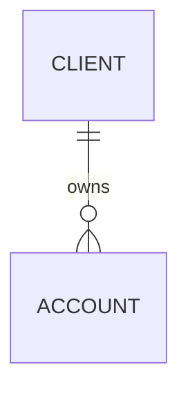

# Enterprise Trading Platform: logical data model

Team:
Version: 0.1
Source: LEAP-BRS-2026-014 v0.9

## 1. Candidate nouns and verbs

| Requirement | Noun or verb found | Entity, attribute, relationship or out of scope |
|---|---|---|
| BR-01 | | |
| BR-04 | | |
| | | |

## 2. Entities

| Entity | Identifier (business or surrogate) | Key attributes | Source requirements |
|---|---|---|---|
| | | | |

## 3. ER diagram

## 4. Requirement traceability

| Requirement | Supported by | Notes |
|---|---|---|
| BR-02 | | |
| BR-04 | | |
| BR-05 | | |
| BR-06 | | |
| BR-08 | | |
| BR-09 | | |
| BR-10 | | |
| BR-11 | | |
| BR-12 | | |
| BR-14 | | |
| BR-15 | | |
| BR-16 | | |

## 5. Open questions

| # | Question | Who can answer | Affects |
|---|---|---|---|
| 1 | | | |
