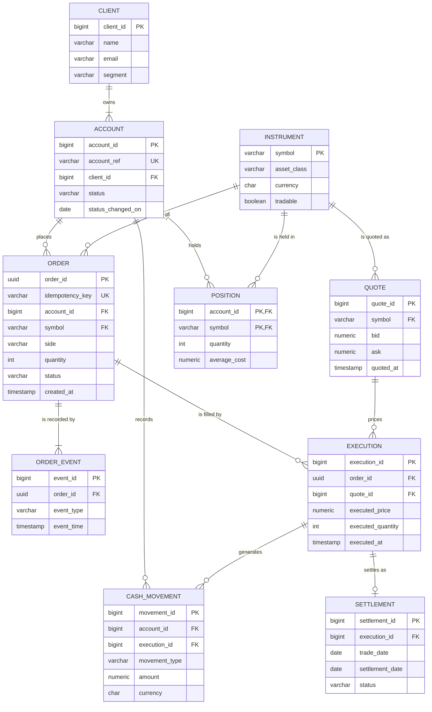

# Enterprise Trading Platform: logical data model (reference solution)

Version: 1.0 (reference)
Source: LEAP-BRS-2026-014 v0.9

This is one defensible model, not the only one. Teams may merge or split entities differently
(for example, one CLIENT with one ACCOUNT, or ORDER_EVENT carrying the fill price instead of a
separate EXECUTION). Mark on reasoning and traceability, not on matching this diagram.

## 1. Candidate nouns and verbs (extract)

| Requirement | Noun or verb found | Decision |
|---|---|---|
| BR-01 | prospective client, register, sign in | CLIENT entity; credentials held by the auth service, out of scope for this model |
| BR-02 | own positions, cash, order history | relationship: ACCOUNT owns POSITION, CASH_MOVEMENT, ORDER |
| BR-03 | session | out of scope (auth service concern) |
| BR-04 | order, buy or sell, supported instrument | ORDER, INSTRUMENT; side is an attribute |
| BR-05 | trading rules, sufficient cash or holding, tradable | attributes: ACCOUNT status, INSTRUMENT tradable; rule outcome recorded as ORDER_EVENT |
| BR-06 | firm commitment, recorded before execution | ORDER row written with status before any EXECUTION exists |
| BR-07 | status change | ORDER status attribute plus ORDER_EVENT history |
| BR-08 | current market quote, point of execution | QUOTE entity; EXECUTION references the quote used |
| BR-09 | holdings, cash, trade record update together | POSITION, CASH_MOVEMENT, EXECUTION written in one transaction (a rule, not an entity) |
| BR-12 | equities, FX, crypto | INSTRUMENT asset_class; the list of values is an open question |
| BR-14, BR-15 | attributable to client and time, full lifecycle, settled as | ORDER_EVENT (append only), SETTLEMENT |
| BR-16 | analyse by instrument, period, client segment | CLIENT segment attribute; reporting copy is a separate store (Module 04) |

## 2. Entities

| Entity | Identifier | Key attributes | Source |
|---|---|---|---|
| CLIENT | client_id (surrogate) | name, email, country, segment, registered_on | BR-01, BR-16 |
| ACCOUNT | account_id (surrogate) plus account_ref (business, ACC-nnnnnn) | client_id, status, status_changed_on, base_currency, opened_on | BR-02, BR-05 |
| INSTRUMENT | symbol (business) | name, asset_class, currency, exchange, tradable | BR-04, BR-12 |
| QUOTE | quote_id (surrogate) | symbol, bid, ask, quoted_at, source | BR-08, BR-13 |
| ORDER | order_id (surrogate UUID) plus idempotency_key (unique) | account_id, symbol, side, order_type, quantity, limit_price, status, channel, created_at | BR-04 to BR-07, BR-11 |
| ORDER_EVENT | event_id (surrogate) | order_id, event_type, event_time, actor, detail | BR-07, BR-14, BR-15 |
| EXECUTION | execution_id (surrogate) | order_id, quote_id, executed_price, executed_quantity, executed_at | BR-08, BR-09, BR-15 |
| POSITION | account_id plus symbol (composite) | quantity, average_cost, updated_at | BR-09, BR-10 |
| CASH_MOVEMENT | movement_id (surrogate) | account_id, execution_id (nullable), movement_type, amount, currency, movement_at | BR-09, BR-10, BR-14 |
| SETTLEMENT | settlement_id (surrogate) | execution_id, trade_date, settlement_date, status, amount | BR-15 |

## 3. ER diagram

## 4. Requirement traceability

| Requirement | Supported by | Notes |
|---|---|---|
| BR-02 | ACCOUNT, CLIENT | every ORDER, POSITION and CASH_MOVEMENT carries account_id; access rule enforced by the API |
| BR-04 | ORDER, INSTRUMENT | side BUY or SELL |
| BR-05 | ACCOUNT.status, INSTRUMENT.tradable, ORDER_EVENT | rule outcome is a REJECTED event with a reason |
| BR-06 | ORDER, ORDER_EVENT | ORDER exists before any EXECUTION; zero executions is valid |
| BR-08 | QUOTE, EXECUTION | EXECUTION records which quote priced it |
| BR-09 | EXECUTION, POSITION, CASH_MOVEMENT | all three written in one database transaction |
| BR-10 | POSITION, CASH_MOVEMENT | cash balance derived from movements or held on ACCOUNT (open question 2) |
| BR-11 | ORDER, EXECUTION | blotter query ordered by created_at |
| BR-12 | INSTRUMENT.asset_class | values beyond EQUITY, ETF, BOND needed (open question 1) |
| BR-14 | ORDER_EVENT, CASH_MOVEMENT | append only; no update or delete |
| BR-15 | ORDER_EVENT, EXECUTION, SETTLEMENT | lifecycle reconstructed by order_id |
| BR-16 | CLIENT.segment, all transactional entities | analysed in a separate reporting store fed by ETL |

## 5. Open questions

| # | Question | Who can answer | Affects |
|---|---|---|---|
| 1 | Which FX pairs, crypto assets and Indian equities are in the launch list, and do fractional quantities apply to crypto? | Trading Desk | INSTRUMENT, ORDER.quantity type |
| 2 | Is the cash balance a stored figure or always derived from cash movements? | Finance | ACCOUNT, CASH_MOVEMENT |
| 3 | Can one order be part filled by several executions? | Trading Desk | ORDER to EXECUTION cardinality |
| 4 | Do DESK-channel orders follow the same trading rules as WEB orders, including for suspended accounts? | Trading Desk, Risk and Compliance | BR-05 enforcement |
| 5 | What are the client segments for BR-16 reporting? | Finance, Programme Sponsor | CLIENT.segment |
| 6 | May a closed account keep positions? | Trading Desk | ACCOUNT, POSITION |
| 7 | How long must order events be retained, and who may read them? | Risk and Compliance | ORDER_EVENT |
