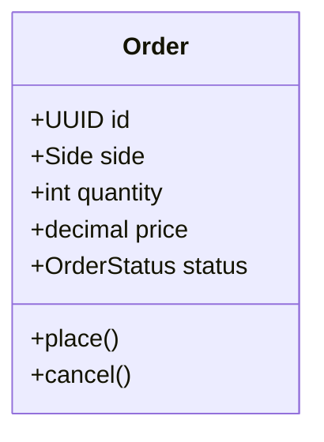
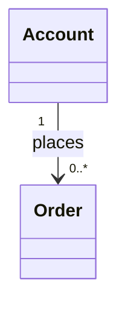
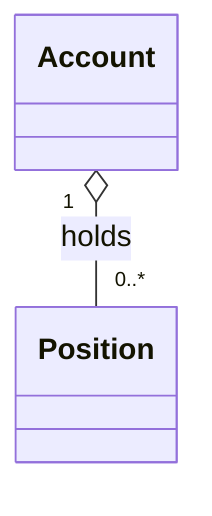
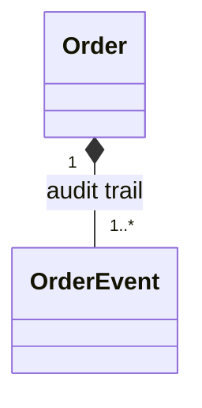
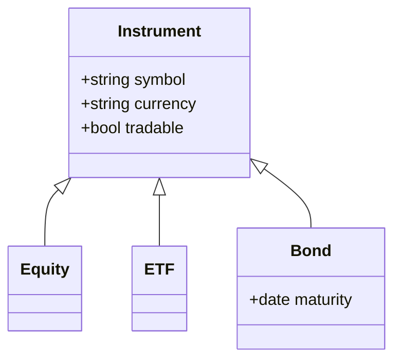
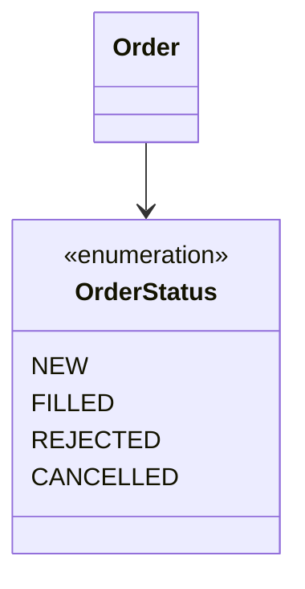

# UML class diagram notation in Mermaid

Each diagram below shows one relationship type from Module 02, using classes from the
Enterprise Trading Platform. GitHub renders the diagrams when this file is viewed in the
browser.

## 1. A class with attributes and operations

## 2. Association with multiplicity

## 3. Aggregation: the part can exist without the whole

## 4. Composition: the part lives and dies with the whole

## 5. Inheritance (generalisation)

## 6. Enumerations

