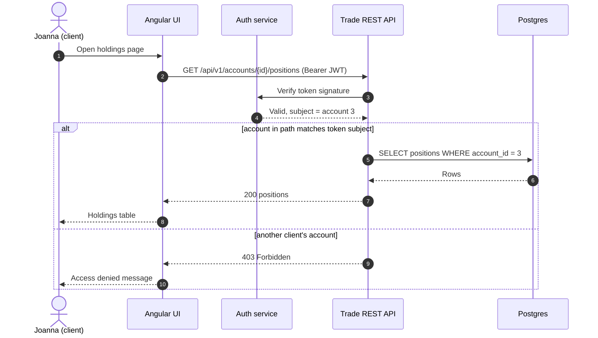

# Sequence diagram: a client views their positions

A worked example for Module 06. It uses the synchronous request and response style: the
client waits for each answer. The trade capture flow in Lab 07 adds the asynchronous part.

Read it top to bottom: time runs down the page. Solid arrows are requests, dashed arrows are
replies. The `alt` block shows the BR-02 rule (a client sees only their own data).
