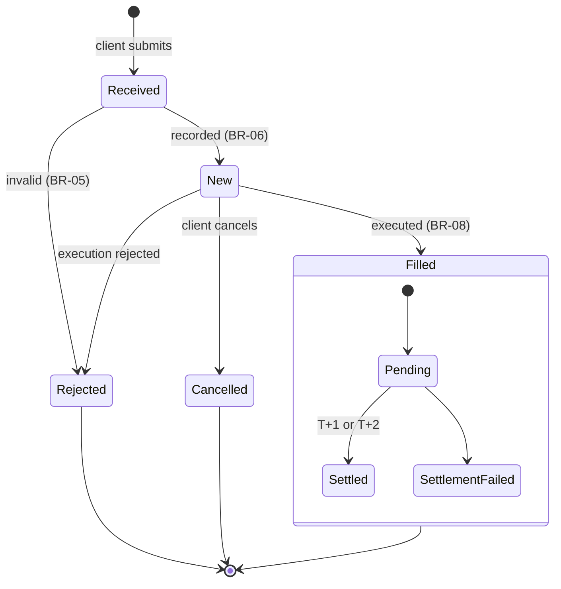
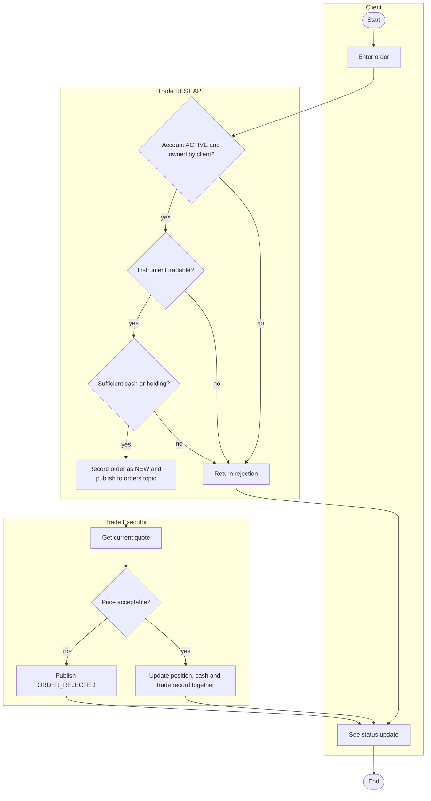

# The lifecycle of a trade: state and activity views

## State diagram: the Order

The states match `orders.status` (NEW, FILLED, REJECTED, CANCELLED) and the audit events in
`order_events` (RECEIVED, VALIDATED, REJECTED, FILLED, CANCELLED).

Rules the diagram states, which the data must obey (Lab 13 tests them):

- A FILLED order has an executed price and time.
- Every state change writes one audit event.
- No transition leaves a terminal state.
- Settlement is T+1 for equities and ETFs, T+2 for bonds.

## Activity diagram: placing an order

Mermaid has no activity diagram type. A flowchart with decision diamonds and swimlanes
(subgraphs) serves the same purpose.

