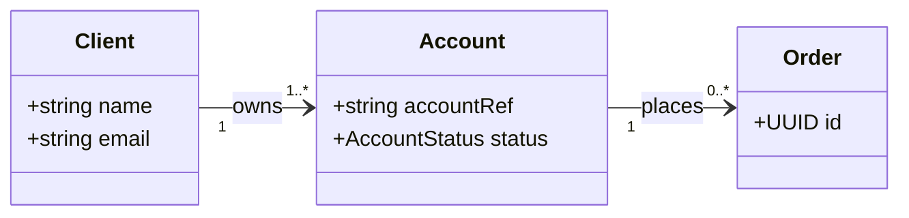

# Trading platform class model (first draft)

Team: <names>

## Traceability

| Class | Responsibility | BR references |
|---|---|---|
| Client | Registers and signs in | BR-01, BR-02 |
| Account | | |
| Order | | |

## Change log

| Change | Reason (review finding) |
|---|---|
| | |
