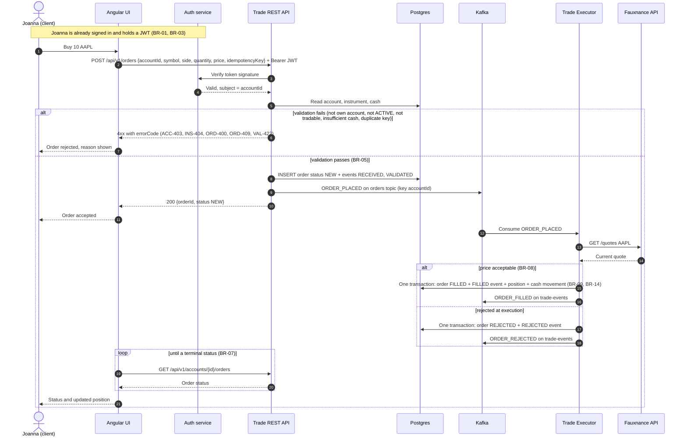

# Trade capture sequence (reference solution)

Validated against `ARCHITECTURE.md`, `trade-api.yaml` (placeOrder), `kafka-topics.md` and
the Business Requirements Specification (BRS).

## Defects in the Copilot draft

| # | Defect | Evidence | Rule broken |
|---|---|---|---|
| 1 | Login inside the order flow | Auth issues the token at sign-in, not per order | ARCHITECTURE.md |
| 2 | UI calls Fauxnance directly and sends its own price | Executor prices at execution; the UI has no API key | BR-08 |
| 3 | Order not recorded before publishing; INSERT happens only on fill | The Trade REST API writes the order as NEW first | BR-06 |
| 4 | Topic named `trades` | Catalogue name is `orders` | kafka-topics.md |
| 5 | No validation step before accepting | Rules 1 to 8 in placeOrder | BR-05 |
| 6 | Position, order and cash updated in three separate writes | Must change together | BR-09 |
| 7 | No audit events written | order_events RECEIVED, VALIDATED, FILLED | BR-14, BR-15 |
| 8 | Executor replies to the API synchronously | Executor publishes to trade-events; nothing waits | ARCHITECTURE.md |
| 9 | Response 201 with status FILLED | Contract returns 200 with status NEW | trade-api.yaml |
| 10 | Endpoint `/orders`, missing accountId and idempotencyKey | `/api/v1/orders` with PlaceOrderRequest | trade-api.yaml |
| 11 | Generic 500 as the only error; no rejection path | Named error codes and a rejected status | trade-api.yaml, BR-07 |
| 12 | No check that the account belongs to the client | Token subject must match accountId | BR-02 |
