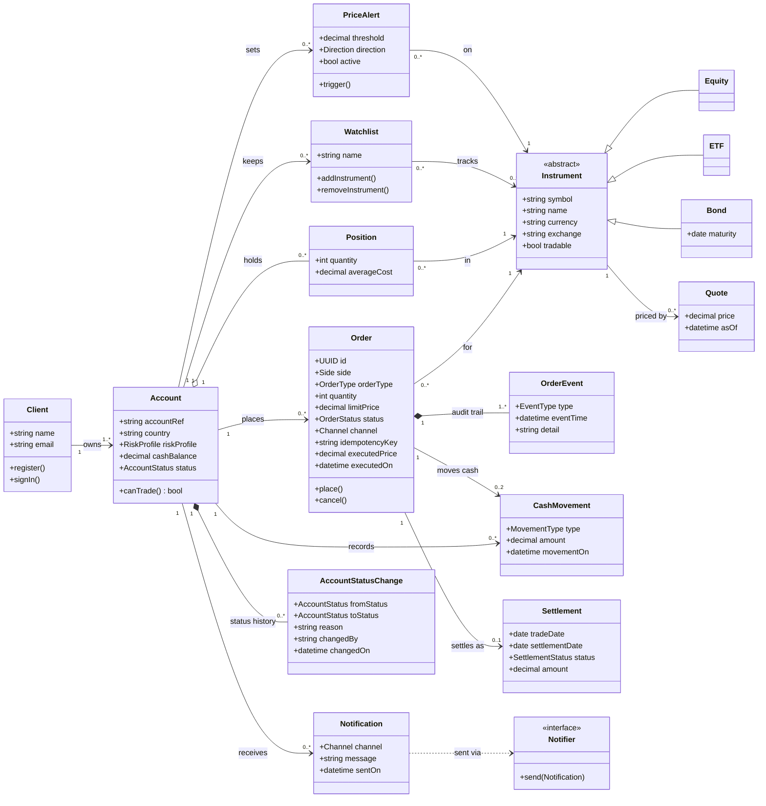

# Trading platform class model (extended reference solution)

One defensible model. Other answers are acceptable where the choice is justified and traced
to the Business Requirements Specification (BRS).

## Traceability

| Class | Responsibility | BR references |
|---|---|---|
| Client | Registers, signs in, sees only own data | BR-01, BR-02, BR-03 |
| Account | Holds cash and positions; decides whether it can trade | BR-02, BR-05, BR-10 |
| Instrument (Equity, ETF, Bond) | Defines what can be traded and whether it is tradable | BR-04, BR-05, BR-12 |
| Order | Records the client's intent, independent of execution | BR-04, BR-06, BR-07 |
| OrderEvent | Permanent audit trail of each state change | BR-14, BR-15 |
| Quote | Current price used at execution | BR-08, BR-13 |
| Position | Current holding, updated with each fill | BR-09, BR-10 |
| CashMovement | Cash in and out, updated with each fill | BR-09, BR-10 |
| Settlement | What the trade settled as | BR-15 |

## Additions traced

| Element | Story or BR |
|---|---|
| Order.cancel() and CANCELLED status | US-03 Cancel an open order; BR-07 |
| Watchlist | US-06 Keep a watchlist (BR-18 candidate) |
| PriceAlert, Notification, Notifier | US-07 Price alert (BR-18 candidate) |
| AccountStatusChange | US-05 Suspended account cannot trade; BR-05, BR-15 |
| Order.channel | US-08 Desk orders follow the same rules; BR-05 |

## Elements with no requirement

- Client.email: needed for notifications (US-07); keep.
- Bond.maturity: no story uses it; keep, needed to derive T+2 settlement. Raise with the
  Trading Desk whether matured bonds must become untradable automatically.
