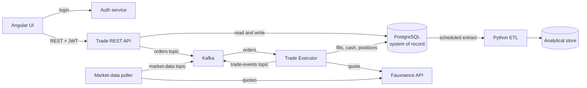
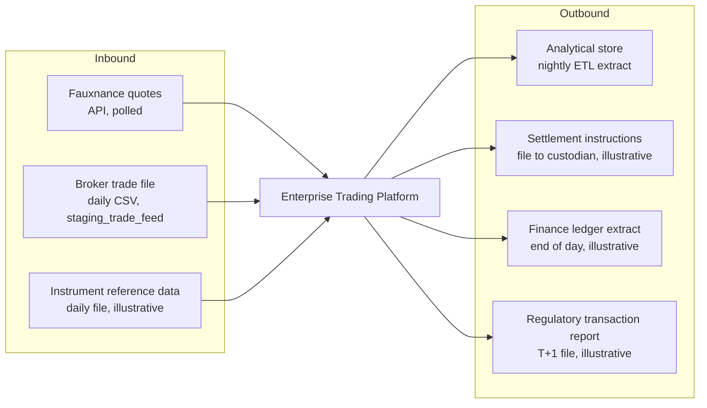

# Enterprise Trading Platform: context and data feeds

Source: `leap-enterprise-trading-platform/docs/ARCHITECTURE.md`. The feeds marked
*illustrative* are not built by the engineering track; they show the kind of file-based and
scheduled integrations a platform of this type has in a firm such as Fidelity.

## Services and stores

## Inbound and outbound feeds

## Questions an analyst asks of every feed

| Question | Example answer for the broker trade file |
|---|---|
| Who owns it, upstream and downstream | Broker A operations; loaded by the platform ETL |
| Format and transport | CSV over SFTP (Secure File Transfer Protocol) |
| Schedule and cut-off | Once per business day, by 06:00 ET (Eastern Time) |
| Volume | A few hundred rows per file |
| What happens when it is late or missing | Reconciliation cannot run; desk alerted |
| What happens to a bad row | Quarantined with a reason code (Week 2 Module 13) |
| Which requirement it serves | BR-15 reconstruction, BR-16 reporting |
