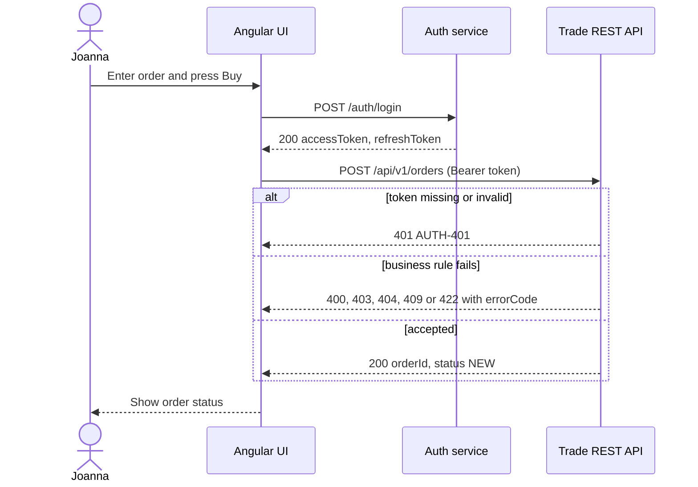

# Place an order: sequence diagram from the contract

Derived from `shared/contracts/trade-api.yaml` (operation `placeOrder`) and
`shared/contracts/auth-api.yaml` (operation `login`). Sprint 7 behaviour: the API returns `NEW`.

## Reading it

- Solid arrows are requests; dashed arrows are responses.
- The `alt` block lists the outcomes the contract allows. Every branch comes from a
  `responses` entry in the YAML.
- The UI must branch on `errorCode`, never on `message` and never on the HTTP status alone:
  404 and 409 each carry two codes.
