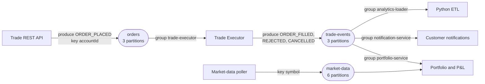

# Order events through Kafka

Source: `shared/contracts/kafka-topics.md`.

## Tracing a missing fill

| Question | Where to look |
|---|---|
| Was the order recorded | `orders` table, status `NEW` |
| Was `ORDER_PLACED` published | `orders` topic, search by `orderId` |
| Did the executor consume it | Consumer group `trade-executor` lag |
| Did it fail and go to the dead-letter topic | `orders.DLT`, failure reason header |
| Was the outcome published | `trade-events`, search by `orderId` |
| Did a downstream consumer process it | That consumer group's lag and its own records |
