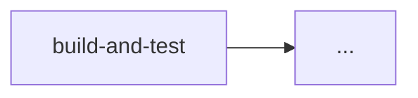

# Change walkthrough: allow a SELL of the entire holding

## 1. Triggers

| Event | Jobs that run |
|---|---|
| Pull request to main | |
| Push (merge) to main | |

## 2. Pipeline diagram

## 3. Stage by stage

| Job | What it checks | Evidence left | If it fails |
|---|---|---|---|
| build-and-test | | | |
| package | | | |
| deploy-dev | | | |
| deploy-test | | | |
| deploy-prod | | | |

## 4. Analyst touch points

| Point in the pipeline | What the analyst provides or decides |
|---|---|
| | |

## 5. Acceptance criterion and regression test

Given

When

Then

Postman test (request and expected result):

## 6. Questions

1. The unit tests pass but the regression suite in test fails. Where is the change now, and
   who is told?
2. What does the approval on `production` prove, and what does it not prove?
3. Why is the same image (`github.sha`) deployed to every environment rather than rebuilt?
