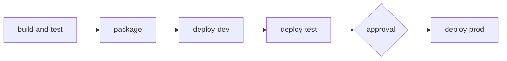

# Change walkthrough: reference solution

## 1. Triggers

| Event | Jobs that run |
|---|---|
| Pull request to main | build-and-test only (`package` has `if: github.event_name == 'push'`, and every later job needs it) |
| Push (merge) to main | build-and-test, package, deploy-dev, deploy-test, deploy-prod (after approval) |

## 2. Pipeline diagram

## 3. Stage by stage

| Job | What it checks | Evidence left | If it fails |
|---|---|---|---|
| build-and-test | Compiles, unit tests (including the new SELL test), contract lint, SonarQube quality gate | Test report, lint output, quality gate result on the pull request | Pull request cannot merge; engineer fixes |
| package | Builds and pushes the container image tagged with the commit | Image in the registry | Nothing is deployed |
| deploy-dev | Deploys the image; health check | Deployment log, smoke test result | Dev keeps the previous version |
| deploy-test | Deploys the same image; Postman regression suite with Newman | Newman report per request | Change stops in dev; not promoted |
| deploy-prod | Named reviewer approves; deploys; health check | Approval record (who, when), deployment log | Production keeps the previous version; rollback by redeploying the previous sha |

## 4. Analyst touch points

| Point in the pipeline | What the analyst provides or decides |
|---|---|
| Before the pull request | The finding and the acceptance criterion (Module 05) |
| build-and-test | Reviews that the unit test matches the acceptance criterion |
| deploy-test | Supplies the Postman regression test; reads the Newman report |
| production approval | Confirms acceptance evidence exists; may be a named approver or consulted by one |
| After release | Release note for the Trading Desk and support |

## 5. Acceptance criterion and regression test

Given account 1 holds 100 ACME and the account is ACTIVE
When the client places a SELL order for 100 ACME at a price greater than zero
Then the order is accepted with status NEW (or FILLED in Sprint 6) and no ORD-409 is returned

Postman test: `POST /api/v1/orders` with `side: SELL`, `quantity` equal to the quantity from
`GET /api/v1/accounts/1/positions`; expect 200. Keep the existing "SELL more than held" test,
expecting 409 `ORD-409`, so the boundary is covered on both sides.

## 6. Questions

1. Deployed in dev only; not promoted. The pipeline run is marked failed and the author (and
   anyone watching the repository) is notified; the team triages the Newman report.
2. That an accountable person agreed to release this build. It does not prove the change is
   correct; the tests and acceptance evidence do that.
3. What is tested is exactly what is released. A rebuild could pick up different
   dependencies, so test evidence would not apply to the production artefact.

## Marking notes

- The most common mistake is saying all jobs run on a pull request.
- Accept any correct Mermaid syntax that matches the `needs:` chain.
- Strong stretch answers note that the order is only `NEW` from the API; whether the executor
  fills it correctly needs an environment with Kafka and the executor running.
