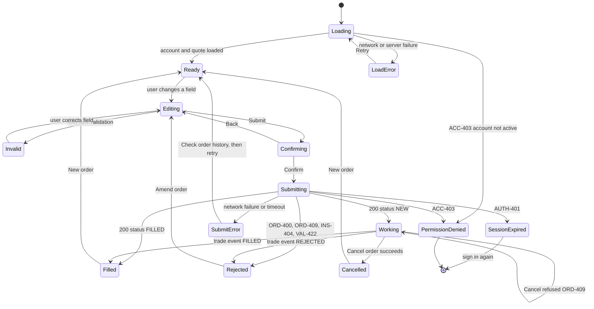

# Order ticket: UI states

Screen: Order ticket (place a buy or sell order). Source stories: US-01, US-02, US-03, US-06.
Contract: `shared/contracts/trade-api.yaml` (`placeOrder`, `cancelOrder`, `getOrders`).

## State notes

| State | What the user sees | Source |
|---|---|---|
| Loading | Skeleton ticket; submit disabled; screen reader hears "Loading order ticket" | US-01 |
| LoadError | Message "We could not load your account. Try again." with a Retry button | Service expectation 9.2 |
| PermissionDenied | Message "This account cannot place orders. Contact support." No form fields shown | ACC-403, BR-02 |
| Invalid | Inline error text beside the field, linked to the field, not colour alone | WCAG 3.3.1 |
| Confirming | Summary of instrument, side, quantity, limit price and estimated cost | BR-05, 9.5 |
| Working | Status "Order received, waiting to execute" with a Cancel button; announced politely | BR-07, status NEW |
| Filled | Executed price and updated cash; announced politely | BR-07, BR-09 |
| Rejected | Plain-language reason mapped from `errorCode`, never from `message` | ErrorResponse |
| SubmitError | "We could not confirm your order. Check your order history before trying again." | Idempotency rule 8 |
| SessionExpired | Return to sign-in; the unsent ticket is not resubmitted automatically | AUTH-401, BR-03 |
| Cancelled | Status "Order cancelled" | cancelOrder |
