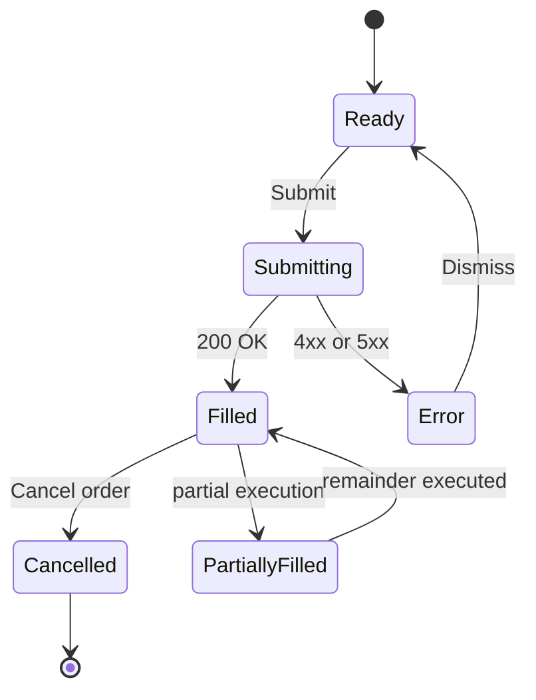

# Order ticket: UI states (AI-generated draft)

Generated by GitHub Copilot Chat from the prompt: "Write a Mermaid state diagram for the order
ticket screen of a retail trading platform. Use trade-api.yaml."

Review this draft before it is used. Do not assume it is correct.

## State notes (AI-generated)

| State | What the user sees |
|---|---|
| Ready | The order form |
| Submitting | A spinner |
| Filled | Green tick and the text "Done" |
| Error | Red banner showing the `message` returned by the API |
| PartiallyFilled | Amber progress bar |
| Cancelled | Grey strike-through on the order |
