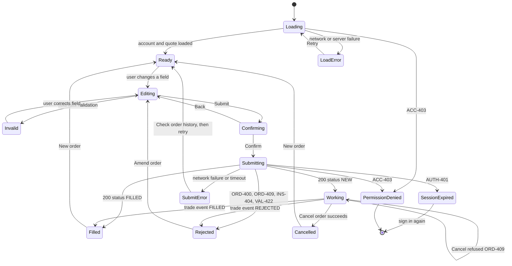

# Order ticket: UI states (reviewed)

Reference solution for Lab 07. Compare with `labs/07-validating-a-screen-spec/ai-generated-states.md`.

## Defects found in the AI-generated draft

| # | Defect | Why it is wrong | Source |
|---|---|---|---|
| 1 | No loading or load error state | The ticket needs the account and a quote before it can be used | Module 06 checklist |
| 2 | 200 always leads to Filled | From Sprint 7 a 200 carries status `NEW`; the order is still working | `placeOrder` description, `OrderStatus` |
| 3 | `PartiallyFilled` state invented | "There is no partial-fill state" | `OrderStatus` description |
| 4 | Filled can be cancelled | Only a `NEW` order can be cancelled; others return `ORD-409` | `cancelOrder` description |
| 5 | One generic Error state for 4xx and 5xx | 401, 403 and business rejections need different screens and actions | `placeOrder` responses |
| 6 | No permission-denied state | `ACC-403` (account suspended, closed or not yours) | `AccountNotActive` |
| 7 | No session-expired state | `AUTH-401`; access tokens expire after fifteen minutes | `auth-api.yaml` claims |
| 8 | No confirmation step | A first-time client should understand the order before it is sent | BRS 9.5, BR-05 |
| 9 | Error shows the API `message` | "For display only. Never branch on this string"; map from `errorCode` | `ErrorResponse` |
| 10 | Status shown by colour and icon only | Fails WCAG 1.4.1 Use of Colour | WCAG 2.2 |
| 11 | Retry after a network failure goes straight back to Ready | The order may already exist; tell the user to check order history | Business rule 8 |

## Corrected diagram

## State notes (reviewed)

| State | What the user sees | Accessibility note |
|---|---|---|
| Loading | Skeleton ticket, Submit disabled, text "Loading order ticket" | Announced once; focus stays on the page heading |
| LoadError | "We could not load your account. Try again." and a Retry button | Retry is keyboard reachable; message in a live region |
| Ready / Editing | The order form with visible labels | Labels are text, not placeholders (1.3.1, 3.3.2) |
| Invalid | Error text beside the field, for example "Enter a whole number of 1 or more" | Text plus icon, linked to the field (3.3.1, 1.4.1) |
| Confirming | Order summary with Confirm and Back | Focus moves to the summary heading (2.4.3) |
| Submitting | "Sending your order" | Confirm disabled to stop a double submit |
| Working | "Order received, waiting to execute" with Cancel | Status in a polite live region (4.1.3) |
| Filled | "Order filled at 25.48. Cash available 24,500.75." | Status text, not a colour tick alone |
| Rejected | Plain reason mapped from `errorCode`, for example ORD-400: "You do not have enough cash for this order." | Announced assertively; focus to the message |
| PermissionDenied | "This account cannot place orders. Contact support." | No form fields rendered |
| SessionExpired | "Your session has ended. Sign in again." | Warning before expiry (2.2.1) |
| SubmitError | "We could not confirm your order. Check your order history before trying again." | Link to order history |
| Cancelled | "Order cancelled" | Text, not strike-through alone |
